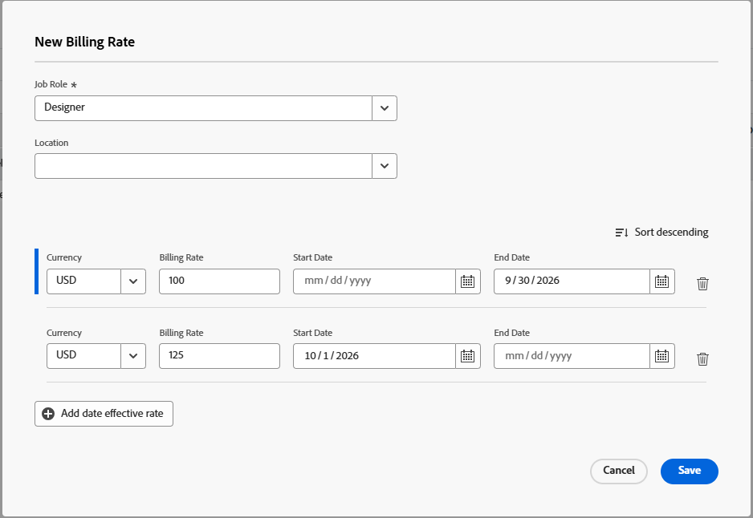
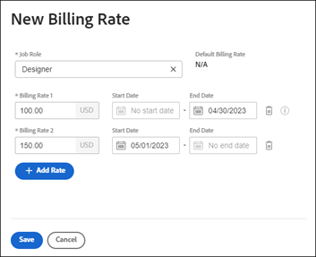

# Substituir taxas de cobrança de função de trabalho no nível da empresa

Quando uma função de trabalho é criada, você tem a opção de selecionar uma taxa de cobrança por hora para essa função. Você pode criar várias taxas de faturamento por hora específicas para uma empresa. Cada taxa de faturamento é efetiva para uma faixa de datas específica.

No nível do projeto, você pode ativar uma opção para permitir que as taxas de cobrança no nível da empresa substituam as taxas no nível do projeto. Para obter mais informações, consulte [Substituir taxas de cobrança no nível do projeto por taxas de cobrança no nível da empresa](../../../manage-work/projects/project-finances/override-project-level-with-company-level-billing-rates.md).

## Requisitos de acesso

+++ Expanda para visualizar os requisitos de acesso da funcionalidade neste artigo.

<table style="table-layout:auto"> 
 <col> 
 <col> 
 <tbody> 
  <tr> 
   <td>[!DNL Adobe Workfront] pacote</td> 
   <td>
Para adicionar atributos de taxa às taxas de faturamento no nível da empresa: Ultimate do Workflow

       
Para criar taxas de faturamento no nível da empresa e editar todas as outras configurações de taxa: Qualquer pacote do Workfront ou Workflow
</td> 
  </tr> 
  <tr> 
   <td>[!DNL Adobe Workfront] licença</td> 
   <td>
[!UICONTROL Padrão]

       
[!UICONTROL Plan]
</td>
  </tr> 
  <tr> 
   <td>Configurações de nível de acesso</td> 
   <td> 
Acesso administrativo a Empresas se você não for um Administrador do sistema

   
Editar acesso a Dados Financeiros
 </td>
  </tr> 
 </tbody> 
</table>

Para obter informações, consulte [Requisitos de acesso na documentação do Workfront](/help/quicksilver/administration-and-setup/add-users/access-levels-and-object-permissions/access-level-requirements-in-documentation.md).

+++

## Substituir ou alterar uma taxa de cobrança estabelecida usada para uma função de trabalho específica

{{step-1-to-setup}}

1. Clique em **[!UICONTROL Empresas]**.
1. Localize a empresa à qual a função de trabalho está atribuída.
1. Clique no nome da empresa na lista.
1. Clique em **[!UICONTROL Taxas de cobrança]** no painel esquerdo.
1. Clique em **[!UICONTROL Adicionar taxa de cobrança]**.
1. Na caixa de diálogo [!UICONTROL Nova taxa de cobrança], selecione uma [!UICONTROL **Função de trabalho**] para definir a taxa de cobrança para.

1. Selecione atributos para a taxa, como Agência, Local ou Centro de Custo.

   Esses atributos são definidos separadamente e podem afetar os cálculos de receita e custo. Para obter mais informações, consulte [Definir atributos de taxa](/help/quicksilver/administration-and-setup/manage-enterprise-operations/define-rate-attributes.md).

   

1. Selecione a **Moeda** para a taxa. O administrador do Workfront adiciona a Moeda base na área Configuração. Você pode alterar a seleção para outra moeda disponível e alterar a moeda em faixas de datas efetivas.

   >[!TIP]
   >
   >Somente as moedas disponíveis na área Taxas de Câmbio do sistema estão disponíveis neste campo. Se você tiver apenas uma moeda configurada, somente essa moeda estará disponível.

   Para obter informações sobre como configurar a Moeda Base no Workfront, consulte [Configurar taxas de câmbio](/help/quicksilver/administration-and-setup/manage-workfront/exchange-rates/set-up-exchange-rates.md).

   Para obter informações sobre como alterar a moeda de um projeto, consulte [Alterar a moeda do projeto](/help/quicksilver/manage-work/projects/project-finances/change-project-currency.md).

1. No campo [!DNL **Taxa de Cobrança**], insira a taxa de cobrança da função de trabalho.

   Esta é a taxa de cobrança por hora da função de trabalho. Esse valor calcula as receitas planejadas e reais de tarefas e problemas associados à função e, por fim, as receitas planejadas e reais dos projetos. Insira a taxa usando a moeda selecionada.

   Se você usar atributos, eles e a função de trabalho serão combinados para definir uma taxa exclusiva. Por exemplo, uma função Designer em Nova York para a Agência A pode ter uma taxa separada de uma função Designer em Paris para a Agência B.

   Para taxas de cobrança efetivas por data, clique em **Adicionar taxa efetiva por data**. Informe a taxa de faturamento por hora para o período e atribua uma Data Inicial e uma Data Final conforme necessário. A primeira taxa de cobrança não terá uma data inicial e a última taxa de cobrança não terá uma data final.

   O Workfront permite que você deixe intervalos entre intervalos de datas, mas você receberá um aviso para confirmar que isso é intencional.

   Para obter informações sobre como a Workfront calcula a receita, consulte [Visão geral de faturamento e receita](/help/quicksilver/manage-work/projects/project-finances/billing-and-revenue-overview.md).

   >[!TIP]
   >
   >Ao editar uma taxa existente, você pode classificar a lista para ver a data de início mais recente no topo da lista de taxas.

1. Clique em [!UICONTROL **Salvar**].

   >[!NOTE]
   >
   >As taxas de função de trabalho alteradas no projeto afetarão somente esse projeto. As taxas alteradas no nível da empresa afetarão todos os projetos aos quais a empresa está atribuída. Para obter mais informações, consulte [Visão geral da substituição de taxas de cobrança e do cálculo de receita em um projeto](/help/quicksilver/manage-work/projects/project-finances/override-role-billing-rates-and-calculate-project-revenue.md).

<!--

   The [!UICONTROL **Default Billing Rate**] displays the system-level rate for this job role.

   

1. In the [!DNL **Billing Rates 1**] field, enter the billing rate. Then, click [!UICONTROL **Save**] to override the billing rate one time.

   Or

   Click [!UICONTROL **Add Rate**] to add more billing rates with effective dates.

1. (Conditional) If you are adding more than one billing rate, enter the following information:

   * **[!UICONTROL Billing Rates 1], 2, etc.**: The value of the billing rate for the time period.
   * **[!UICONTROL Start Date]**: The date when the rate becomes effective.
   * **[!UICONTROL End Date]**: The date when the rate ends.

     Billing Rate 1 will not have a start date and the last billing rate will not have an end date. Some dates are added automatically. For example, if Billing Rate 1 does not have an end date, and you add Billing Rate 2 with a start date of May 1, 2023, an end date of April 30, 2023 is added to Billing Rate 1 so that no gaps exist.

1. Click [!UICONTROL **Save**].

   >[!NOTE]
   >
   >Job role rates changed on the project will only impact only that project. Rates changed at the company level will impact all projects. For more information, see [Overview of overriding billing rates and calculating revenue on a project](/help/quicksilver/manage-work/projects/project-finances/override-role-billing-rates-and-calculate-project-revenue.md).

-->

