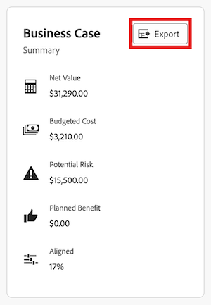

# Exportar o business case de um projeto

Você pode exportar o Business Case para um arquivo PDF caso precise imprimi-lo ou anexá-lo a um email em um formato mais condensado.

## Requisitos de acesso

+++ Expanda para visualizar os requisitos de acesso da funcionalidade neste artigo.

<table style="table-layout:auto"> 
 <col> 
 <col> 
 <tbody> 
  <tr> 
   <td role="rowheader">
Pacote do Adobe Workfront
</td> 
   <td> 
Prime ou superior 
  </td> 
  </tr> 
  <tr> 
   <td role="rowheader">
Licença do Adobe Workfront
</td> 
   <td> 
   
Leve ou superior

   
Revisar ou superior
 </td> 
  </tr> 
  <tr> 
   <td role="rowheader">Configurações de nível de acesso</td> 
   <td> 
Visualizar o acesso ao Gerenciamento de projetos, dados financeiros e recursos
 </td> 
  </tr> 
  <tr> 
   <td role="rowheader">Permissões de objeto</td> 
   <td> 
Exibir permissões do projeto ou superiores
 </td> 
  </tr> 
 </tbody> 
</table>

Para obter informações, consulte [Requisitos de acesso na documentação do Workfront](/help/quicksilver/administration-and-setup/add-users/access-levels-and-object-permissions/access-level-requirements-in-documentation.md).

+++

## Exportar o Business Case

{{step1-to-projects}}

1. Na página **Projetos**, selecione o projeto do qual deseja exportar o Business Case.
1. Clique em **Business Case** no painel esquerdo.
1. No canto superior direito da área **Resumo do Business Case**, clique em **Exportar**. Um arquivo do PDF é baixado no computador.

   

