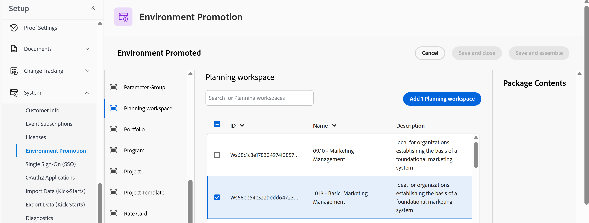

# Usar a promoção de ambiente para o Adobe Workfront Planning

<!--add to TOC-->
<!--add to miniTOC-->

<!--
Not sure if this bit will ever be needed because this only exists when both Preview and Prod have the features in parity. Features released here always come to both environments at the same time: 

The information on this page refers to functionality not yet generally available. It is available only in the Preview environment for all customers. After the release to Preview, the same features are also available monthly in the Production environment for customers who enabled fast releases.    

For information about fast releases, see [Enable or disable fast releases for your organization](/help/quicksilver/administration-and-setup/set-up-workfront/configure-system-defaults/enable-fast-release-process.md). 
-->

{{planning-important-intro}}

<!--if Lilit says this is not for STA, break the intro and specify that; she is checking on this-->

Você pode copiar espaços de trabalho, tipos de registro, campos e exibições do Workfront Planning de um ambiente Workfront para outro usando os recursos de Promoção do Ambiente.

Em vez de reconstruir tudo manualmente, você monta a configuração em um pacote no ambiente de origem e o instala no ambiente de destino.

O uso da Promoção do ambiente com o Planning é semelhante ao uso dela para o Workfront. Para obter mais informações, consulte a seção &quot;Promoção do ambiente&quot; no artigo [Ambientes de teste do Adobe Workfront](/help/quicksilver/administration-and-setup/set-up-workfront/workfront-testing-environments/wf-testing-environments.md).

## Considerações sobre o uso da Promoção do ambiente com o Planning

* Você deve ser um administrador do Workfront para usar a Promoção do ambiente.
* Os itens a seguir são importados por meio da promoção do ambiente:

  * Espaços de trabalho
  * Seções do Workspace
  * Tipos de registro
  * Campos
  * Exibições
  * Hierarquias
  * Configurações de compartilhamento para todos os objetos
  * Automações <!--this might not be part of it; Lilit is checking-->
  * Formulários de solicitação
  * Regras de negócios
  * Objetos conectados
  * Objetos dos quais o espaço de trabalho depende ou com os quais outros objetos são compartilhados, como grupo, equipes, funções de trabalho. Existem os seguintes cenários:

    * Se um objeto com o mesmo nome já existir no ambiente de destino, o Workfront sinalizará um conflito e você decidirá como tratá-lo.
    * Se uma equipe ou grupo com o qual um objeto é compartilhado não existir no ambiente de destino, a promoção o criará.
* Para cada objeto, você pode fazer o seguinte:

  * Criar como um novo objeto
  * Usar o objeto existente, mas criar com um novo nome
  * Substituir um objeto existente. A substituição substitui a configuração no público-alvo.

* A instalação pode levar alguns minutos. Você pode reverter uma instalação da página de resultados, se necessário.
* Recomendamos testar o processo antes de prosseguir, quando possível. Você pode instalar em uma sandbox ou ambiente de Pré-visualização antes de promovê-lo para produção.

## Requisitos de acesso

+++ Expanda para visualizar os requisitos de acesso da funcionalidade neste artigo. 

<table style="table-layout:auto"> 
<col> 
</col> 
<col> 
</col> 
<tbody> 
<tr> 
   <td role="rowheader">
Pacotes Adobe Workfront
</td> 
   <td> 

Pacote de fluxo de trabalho do Prime ou Ultimate com um pacote do Prime ou Ultimate Planning

Pacote de planejamento do Prime ou Ultimate quando adquirido como um produto independente

   </td> 
   </tr>
  <tr> 
   <td role="rowheader">
Licença do Adobe Workfront
</td> 
   <td>
Workflow Standard
    
  </td> 
  </tr> 
  <tr> 
   <td role="rowheader">
Licença do Planning
</td> 
   <td>
Planejamento padrão
 
  </td> 
  </tr> 
  <tr> 
   <td role="rowheader">
Configuração do nível de acesso
</td> 
   <td> 
Você deve adicionar um Workflow e um tipo de licença do Planning ao nível de acesso quando tiver um Workflow e um pacote do Planning
  
   
Você precisa ser um Administrador do sistema
 
</td> 
  </tr> 
  <tr> 
   <td role="rowheader">
Permissões de objeto
</td> 
   <td>   
Gerenciar permissões para espaços de trabalho
  
   
Os administradores do sistema têm permissões para todos os espaços de trabalho, incluindo aqueles que não criaram
  
   </td> 
  </tr>  
</tbody> 
</table>

Para obter mais informações sobre requisitos de acesso do Workfront, consulte [Requisitos de acesso na documentação do Workfront](/help/quicksilver/administration-and-setup/add-users/access-levels-and-object-permissions/access-level-requirements-in-documentation.md).

+++

## Importar configuração do Planning usando a Promoção do Ambiente

Estas são as principais etapas para promover a configuração do Planning para outro ambiente:

* [Criar um pacote no ambiente de origem](#create-a-package-in-the-source-environment)
* [Prepare o pacote para a instalação](#make-the-package-ready-to-install)
* [Instalar o pacote no ambiente de destino](#install-the-package-in-the-target-environment)
* [Verifique os resultados](#verify-the-results)

Siga as instruções nas seções a seguir para copiar uma configuração do Planning entre dois ambientes do Workfront.

### Criar um pacote no ambiente de origem

1. Ter um ambiente de origem no qual a configuração desejada esteja estabelecida.
1. No ambiente de origem, clique no **Menu Principal**  e vá para **Instalação** > **Sistema** > **Promoção do Ambiente**.
A lista **Pacotes de Configuração** mostra pacotes existentes com seu status, ambiente de origem e onde eles foram implantados.
1. Clique em **Criar pacote**.

   >[!TIP]
   >
   >Um pacote precisa de pelo menos um objeto para ser montado e instalado.
1. Na guia **Detalhes do Pacote**, digite um **Nome** e uma **Descrição** para o pacote. O ambiente de origem já está preenchido com o ambiente atual (origem).
1. Na lista de tipos de objetos à esquerda, selecione **espaço de trabalho do Planning**.
1. Procure o espaço de trabalho que deseja promover, marque a caixa de seleção correspondente e clique em **Adicionar espaço de trabalho do Planning**. O espaço de trabalho aparece em **Conteúdo do Pacote**.

   
1. Clique em **Salvar e reunir**.

   A Workfront monta o pacote e adiciona uma entrada na guia **Atualizações** do pacote. É possível revisar o que o pacote inclui na guia Contents.
1. (Condicional e opcional) Clique em **Salvar e fechar** se desejar terminar mais tarde.
1. (Opcional) Clique em **Conteúdo** para examinar o conteúdo do pacote ou clique em **Implantações** para ver se este pacote foi implantado várias vezes.

   Continue a preparar o pacote para instalação.

### Prepare o pacote para a instalação

Antes de instalar o pacote no ambiente de destino, recomendamos testá-lo em um ambiente de teste.

1. Depois que o pacote terminar a compilação conforme descrito na seção anterior, clique em **Detalhes do Pacote** e em **Editar**, defina o **Status** como **Testes** e clique em **Salvar e fechar**.

   >[!TIP]
   >
   >Após a compilação do pacote, seu status é definido como **Rascunho**. O status **Ativo** não estará disponível até que você tenha testado o pacote primeiro.
1. (Recomendado) Clique em **Instalar** e escolha um dos ambientes de teste disponíveis para implantá-lo e testar a configuração.

   >[!TIP]
   >
   >O ambiente de Produção não está disponível como uma das opções quando o status é definido como **Testing**.

1. Depois de instalá-lo em um ambiente de teste, clique novamente em **Editar** e defina o **Status** como **Ativo**. Em seguida, clique em **Salvar e fechar**.

   >[!TIP]
   >
   >A instalação do pacote em um ambiente de teste é semelhante à instalação dele na Produção, conforme descrito na seção a seguir.

   Prossiga com a seção a seguir para instalar o pacote no ambiente de destino.

### Instalar o pacote no ambiente de destino

1. Na página do pacote, depois de verificá-lo, clique em **Instalar**.
1. Na lista **Ambiente de destino**, selecione o ambiente no qual implantar (por exemplo, seu ambiente de Produção) e clique em **Continuar**. O destino padrão é o ambiente atual.
1. Na página **Informações do pacote**, confirme o ambiente de origem e o ambiente no qual você está implantando.
1. Na seção **Mapeamento de objeto**, expanda cada agrupamento de objeto, como **Grupo** e **espaço de trabalho do Planning**, para examinar os objetos.
1. Para cada objeto, revise as colunas **Colisão** e **Status** e escolha uma **Ação de implantação** na lista. Escolha entre as seguintes opções:

   * **Criar novo**: adiciona o objeto ao destino. Use isto quando nenhuma colisão for detectada.
   * **Usar existente**: mapeia o objeto para um que já existe no destino, como um grupo com o mesmo nome.
   * **Criar com novo nome**: adiciona o objeto com um nome especificado por você.
   * **Substituir**: substitui o objeto existente no destino pelo do pacote.
1. (Opcional) Para alterar vários objetos de uma só vez, marque suas caixas de seleção, escolha uma ação na lista Ação de implantação na parte superior do grupo e clique em Aplicar à selecionada. Use os filtros acima da lista, como Mostrar apenas erros, para focalizar objetos específicos.
1. Resolva qualquer indicador de erro. Se você selecionar **Usar existente** para um objeto, também deverá selecionar o objeto para o qual ele é mapeado.  Caso contrário, o status mostrará um erro e **Implantar** permanecerá indisponível.
1. Clique em **Implantar** e depois em **Implantar** para confirmar.

   O Workfront mostra uma página de instalação com a mensagem **Este pacote está sendo instalado**. Isso pode levar alguns minutos.

   Quando a instalação for concluída, a página mostrará uma mensagem de sucesso, o ambiente no qual o pacote foi instalado e uma lista dos objetos instalados, com status para cada um, como **Usado existente** ou **Instalado (Criar novo)**.
1. (Opcional) Clique em **Reverter instalação**, se necessário, para reverter a instalação e remover a configuração do ambiente de destino.

   Continue a verificar os resultados da instalação.

### Verifique os resultados

1. Vá para o ambiente de destino > **Menu Principal** > **Planning** e localize o espaço de trabalho importado.
1. Abra os tipos e as exibições de registro para confirmar se os campos e o layout correspondem à origem. Os registros não são incluídos, portanto, as tabelas ficam vazias.

