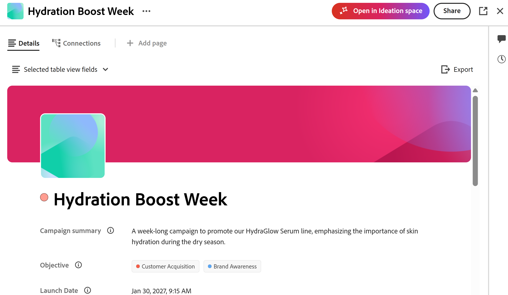
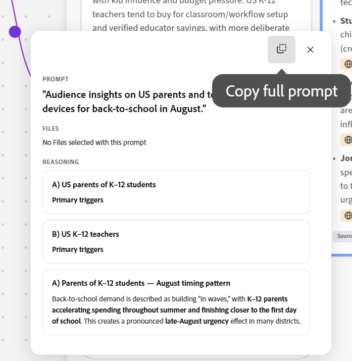

# Criar resumos no espaço de ideação

<!--add to TOC and miniTOC-->

As informações nesta página se referem a funcionalidades que ainda não estão disponíveis. Ele está disponível somente como parte do programa **Espaço de ideação Beta**. 

Para obter mais informações, consulte [Introdução ao Espaço de ideação para o Adobe Workfront Planning](/help/quicksilver/planning/ideation/get-started-with-planning-ideation.md).

>[!IMPORTANT]
>
>As informações neste artigo se referem à funcionalidade disponível somente para clientes do Workfront que também têm o Adobe Workfront Planning. Sua empresa deve adquirir um pacote adicional do Planning.
>
>A funcionalidade descrita aqui não estará disponível se sua organização tiver adquirido o Workfront Planning como um produto independente.
>
>Para obter informações gerais sobre o Workfront Planning, consulte [Introdução ao Adobe Workfront Planning](/help/quicksilver/planning/general/planning-overview.md).
> 
>

<!--
Future - when they make it available in Planning: replace the above with this OR ... insert the snippet:

>[!IMPORTANT]
>
>The information in this article refers to Adobe Workfront Planning which your organization can purchase either as an Adobe Workfront package or a standalone product. 
>
>Not all capabilities included in the Planning package are available to Workfront Planning when it is purchased as a standalone product. 
>
>For general information about Workfront Planning, see [Get started with Adobe Workfront Planning](/help/quicksilver/planning/general/planning-overview.md).
> 
>For information about Workfront Planning as a standalone product, see [Get started with Adobe Workfront Planning as a standalone product](/help/quicksilver/planning/planning-sta/planning-sta-overview.md). 
>
-->

Usando o Espaço de ideação, um novo recurso do Adobe Workfront Planning, você pode transformar resumos em registros do Planning ou salvá-los como um arquivo externo. Os resumos exportados criam novos registros ou atualizam os existentes.

Este artigo descreve como você pode fazer um brainstorming e criar estratégias no espaço de ideação para criar resumos.

Você pode fazer o seguinte:

* Para criar ou atualizar registros, exporte os resumos de ideação concluídos para o Workfront Planning.

* Para usar as informações de um resumo em outro aplicativo, exporte-o para um dos seguintes tipos de arquivo:

  * PDF
  * Palavra
  * PowerPoint
  * Modelo do PowerPoint

## Requisitos de acesso

+++ Expanda para exibir os requisitos de acesso para a funcionalidade neste artigo. 

<!--
are there additional license restrictions or packages to be purchased to have access to Ideation space?? If yes, update the table below
-->

<table style="table-layout:auto"> 
<col> 
</col> 
<col> 
</col> 
<tbody> 
    <tr> 
<tr> 
</tr> 
<tr> 
   <td role="rowheader">
Requisitos do provedor de nuvem
</td> 
   <td>
Amazon Web Services (AWS)

   
<b>NOTA:</b>

   
Não oferecemos suporte a nenhum outro provedor de nuvem.

   </td> 
  </tr>
<tr> 
   <td role="rowheader">
Pacote do Adobe Workfront
</td> 
   <td> 
<ul> 
<li>
Qualquer fluxo de trabalho com um pacote de planejamento
</li>
<!--
Add this at GA - not available in beta:
Or
<li>
Any Planning package when purchased as a standalone product
</li>
-->
</ul>
   </td> 
<!--
<tr> 
<td role="rowheader">
Additional products
</td> 
<td><ul>
<li>
Adobe GenStudio for Performance Marketing
</li>
<li>
Adobe Customer Journey Analytics
</li>
</ul>
</td> 
</tr> 
-->
<tr> 
   <td role="rowheader">
Requisitos do sistema
</td> 
   <td>
As configurações de preferências de Colaborador e MCP nas Preferências do Sistema na área Configuração devem estar ativadas

   </td> 
  </tr> 
  <tr> 
   <td role="rowheader">
Licença do Adobe Workflow
</td> 
   <td>
Padrão

   </td> 
  </tr> 
<tr> 
   <td role="rowheader">
licença do Adobe Planning
</td> 
   <td>
Padrão

   </td> 
  </tr>  
<tr> 
   <td role="rowheader">
Configuração do nível de acesso
</td> 
   <td> 
   <ul>
   <li>
Você deve adicionar um tipo de licença do Workflow e do Planning ao nível de acesso <!--when you have both a Workflow and a Planning package-->
   </li>
   <li>
A configuração Desativar espaço de ideação no seu nível de acesso deve ser desmarcada
</li>
   <li>
A configuração Desativar o painel CX Coworker no Workfront no seu nível de acesso deve ser desmarcada
</li></ul>
</td> 
  </tr>  
   <tr> 
   <td role="rowheader">
Permissões de objeto
</td> 
   <td> 
Permissões do Contribute ou superior para o espaço de trabalho e tipo de registro ao qual você deseja adicionar registros 

      
Os administradores do sistema têm permissões para todos os espaços de trabalho, incluindo aqueles que não criaram

      <!--
      not available right now:
      
View permissions to Workfront objects to add them to briefs 

      -->
      
Permissões do editor no espaço de ideação para criar resumos

   </td> 
  </tr>  
    <!--
    <tr> 
    <td role="rowheader">
Adobe GenStudio for Performance Marketing user roles
</td> 
    <td>
<ul><li>Any GenStudio user role to access Campaigns, Products, and Personas</li>
    <li>GenStudio System Manager to access Activations and Events</li></ul>
    For information, see <a href="https://experienceleague.adobe.com/pt-br/docs/genstudio-for-performance-marketing/user-guide/intro/user-roles">User roles and permissions</a>. 
    

    </td> 
    </tr> 
    -->
</tbody> 
</table>

Para obter mais informações sobre requisitos de acesso do Workfront, consulte [Requisitos de acesso na documentação do Workfront](/help/quicksilver/administration-and-setup/add-users/access-levels-and-object-permissions/access-level-requirements-in-documentation.md).

+++  

## Criar resumos do espaço de ideação

Você pode criar resumos para criar ou editar registros do Planning ou criar arquivos que podem ser exportados para outros aplicativos.

1. Faça logon no Workfront com Planejamento, onde o Colaborador foi ativado, e siga um destes procedimentos para abrir o espaço de ideação pela primeira vez e criar resumos:

   * Vá para o **Menu principal**  > clique em **Espaço de ideação**

     

   * Vá para **Menu principal**  > **Planejamento** > clique em um espaço de trabalho > clique em um tipo de registro > clique em **Novo registro** > clique em **Iniciar espaço de ideação**

     

   * Vá para **Menu Principal**  > **Planejamento** > clique em um espaço de trabalho > clique em um tipo de registro > clique em um registro existente > clique em **Abrir no Espaço de ideação**

     

1. Leia o contrato beta e clique em **Concordo**. Você deve assinar o contrato para usar o espaço de ideação.

   A tela Espaço de ideação é aberta e uma nova ideação é intitulada por padrão após o seguinte formato:

   `catalyze-canvas-< number > - Month date, year at time` <!--submitted bug to change the default name to "Untitled ideation"-->

   Para obter mais informações sobre como criar registros usando o espaço de ideação, consulte [Criar registros do Planning a partir de resumos do espaço de ideação](/help/quicksilver/planning/ideation/create-records-in-ideation-space-for-planning.md).

1. (Condicional) Para abrir um resumo existente no espaço de ideação, faça logon no Workfront com o Planning onde o Co-worker foi ativado e siga um destes procedimentos:

   * Vá para **Menu Principal**  > **Planejamento** > clique em um espaço de trabalho > clique em um tipo de registro > clique em um registro existente > **Abrir no espaço de ideação**

     O nome da ideação corresponde ao nome do registro.

1. (Recomendado) Clique no nome da ideação para alterar o nome, se você a abriu pela primeira vez.

1. (Condicional e opcional) Para abrir outro espaço de ideação existente, clique no menu suspenso à direita do nome da ideação, procure-o pelo nome e clique na ideação quando ela for exibida na lista.

   O **Espaço de ideação** é aberto e o Colaborador é aberto à direita.
1. Use o prompt de colaborador para descrever o tipo de resumo que deseja criar.

   Por exemplo, digite &quot;Create a back-to-school campaign for K-12 student to run through the month of August, for parent and professors in the US&quot; (Crie uma campanha de volta às aulas para os alunos do ensino fundamental que durará o mês de agosto para os pais e os professores nos EUA).  Para tornar o resumo o mais completo possível, indique quantas informações você tem disponíveis para que tipo de campanha, a linha do tempo, as partes interessadas, pontos de verificação de aprovações e outros detalhes.
1. (Opcional) Clique no ícone **+** na caixa de prompt Colaborador e anexe informações das seguintes maneiras:

   * **Comandos**: use um comando da lista para solicitar conteúdo ao Co-worker.
   * **Anexar arquivo**: anexe um arquivo à caixa de prompt para adicioná-lo ou suas informações à tela de ideação. Você deve pedir ao Coworker para criar cartões com base no arquivo para depois enviar os cartões ao resumo.
   * **Referenciar um objeto**: selecione um objeto da lista para referenciá-lo na sua ideação. O objeto deve existir no Workfront.

1. Clique em Enter.

1. Responda as perguntas do Colaborador para continuar a ideação e clique em **Enviar**

   Ou

   Clique em **Ignorar questionário** para ignorar perguntas adicionais.

1. (Condicional) Quando o Colaborador oferecer a criação de cartões para a ideação, responda **Sim**.

   Os cartões são adicionados à tela de ideação e você pode ver as fontes de cada cartão e decidir qual deles adicionar ao seu resumo.

   >[!TIP]
   >
   >Não é possível adicionar arquivos diretamente ao resumo. Você deve primeiro transferir as informações do arquivo para os cartões que você pode enviar ao resumo.

1. Clique no ícone **Pesquisar**  para procurar itens na tela de ideação e clique quando ele for exibido na lista para navegar até ele.

1. (Opcional) Clique em **Fontes** na parte inferior de cada cartão para entender de onde as informações foram coletadas.

   As informações podem ser importadas do Workfront Planning ou da Web.

   Você também pode clicar no ícone **Fontes** ícone  no canto superior direito do espaço para exibir uma lista de fontes para todos os cartões no espaço.
1. (Opcional) Clique em **Comentários**  no canto superior direito do espaço e **@** marque outros para começar a fazer brainstorming dentro do espaço.

   Os usuários receberão uma notificação por email sobre a tag.
1. (Opcional) Clique no ícone **Filtro**  dentro do cartão de comentários para filtrar os comentários de acordo com os seguintes critérios:

   * Revisores
   * Hora em que o comentário foi adicionado
   * Status (onde o comentário foi resolvido ou está pendente)
   * Não lido (mostra somente comentários não lidos)
1. (Opcional) Use os ícones **Polegar para cima** ou **Polegar para baixo** em um cartão  para fornecer feedback sobre a precisão das informações no cartão.
1. Clique em um cartão ou no quadro que contém todos os cartões e, em seguida, clique em **Adicionar ao resumo** para adicionar suas informações ao resumo.

   O Workfront corresponde cada informação ao campo que encontra com maior probabilidade de armazená-la.

   Por exemplo, linhas do tempo são adicionadas a campos do tipo data, descrições a campos do tipo parágrafo.

1. (Condicional) Clique em um cartão e em **Pedir IA para ...** para obter ideias sobre a próxima etapa antes de adicionar as informações ao resumo. As respostas estão no contexto das informações de cada cartão.
1. Clique no ícone **Adicionar documentos**  no canto superior esquerdo da tela de ideação para carregar documentos para o espaço. É possível adicionar novos documentos ou documentos que já foram adicionados ao espaço anterior.

   >[!TIP]
   >
   >A configuração Documentos deve estar ativada para poder acessar documentos e carregá-los no espaço.
   >Para obter informações, consulte a seção [Configurar a tela do espaço de ideação](#configure-the-ideation-space-canvas) neste artigo.
   > 
1. Clique no ícone **Adicionar registros do Workfront Connected Planning**  e selecione um tipo de registro conectado e, em seguida, um registro de cada tipo para adicionar as informações desse registro ao tipo de registro selecionado.

   Um cartão é criado para o registro selecionado para ser adicionado ao espaço. O tipo de registro é exibido no canto superior esquerdo do cartão do registro.

   >[!TIP]
   >
   >* O ícone **Adicionar registros do Workfront Connected Planning** não está disponível quando você acessa o espaço Ideação no menu Principal e o resumo não é conectado a um registro do Planning.
   >
   >* Somente os registros de planejamento conectados estarão disponíveis para serem adicionados à tela Espaço de ideação como contexto para sua ideação. Cada cartão de registro conectado adicionado à tela influenciará o tipo de conteúdo criado e usará esse contexto, onde aplicável, durante sua ideação.
   >
   >   Por exemplo, se você deseja criar uma campanha que deve aproveitar os tipos de registro existentes, adicione esses registros à tela.

1. (Opcional) Clique no menu **Mais**  no cartão de registro conectado e clique em **Exibir no Workfront**.

   A página de detalhes do registro é aberta em outra guia do navegador no Workfront Planning.
1. (Opcional) Selecione o quadro de ideação ou um cartão, clique no ícone **Excluir** e em **Excluir** para confirmar. A placa é removida da tela Espaço de ideação.

   Quando você exclui cartões correspondentes a um documento armazenado ou a um registro, os itens são removidos da tela, mas permanecem em seus respectivos aplicativos.

1. (Opcional) Use a caixa **Pergunte qualquer coisa ao Colaborador** no canto inferior direito a qualquer momento para refinar sua ideia.

   Por exemplo, digite `regenerate` para que um cartão específico faça com que a IA o refaça usando o contexto atualizado. O espaço de ideação reexecuta suas etapas de raciocínio (pesquisa, síntese, citação) e atualiza os cartões afetados.

1. (Opcional) Clique em um dos conectores roxos de qualquer conjunto de cartão de ideação e clique no ícone **Copiar prompt completo** para copiar o prompt que gerou o cartão para a área de transferência e, em seguida, cole-o na caixa de prompt do Co-worker.

   

1. (Opcional) Clique nos ícones **Desfazer** ou **Refazer**  na parte superior da tela para cancelar ou reverter uma ação.
1. Reduza o zoom para ver a imagem completa: seu objetivo original de campanha, todos os cartões de conceito gerados por IA com citações, documentos adicionais, os registros reais do Workfront Planning que você obteve (produtos, personas etc.). O cartão de resumo **Brief** no canto inferior esquerdo puxa tudo junto.

1. Clique na imagem de visualização breve no canto inferior esquerdo, revise o resumo e clique em uma das seguintes opções:

   * **Exportar para arquivo**. Você pode exportar o resumo para os seguintes tipos de arquivo:

     * PDF
     * Palavra
     * PowerPoint (com ou sem um modelo)
   * **Exportar para o Workfront Planning**. A exportação substitui todos os dados de campo existentes no registro de Planejamento correspondente à ideação.

   >[!TIP]
   >
   >**Exportar para o Workfront Planning** fica esmaecido quando você acessa o espaço Ideação no menu Principal e o resumo não é conectado a um registro do Planning.

   Isso finaliza a criação do registro ou do arquivo com as informações adicionais. Se você tiver começado a partir de um registro existente, as informações do resumo serão adicionadas ao registro. Se você começou com um novo registro, ele é criado com as informações do resumo.

   Para obter mais informações sobre a atualização de registros do Planning usando resumos, consulte a seção &quot;Considerações sobre o uso do espaço de ideação para criar registros&quot; no artigo [Criar registros do Planning a partir de resumos do espaço de ideação](/help/quicksilver/planning/ideation/create-records-in-ideation-space-for-planning.md).
1. (Opcional) Clique em **Compartilhar** para compartilhar a tela de ideação com outras pessoas.

   Para obter mais informações, consulte [Compartilhar um espaço de ideação com outras pessoas](/help/quicksilver/planning/ideation/share-the-ideation-space.md).

## Configurar a tela do espaço de ideação

Existem controles para o espaço de ideação que configuram o que você vê na tela, bem como ajudam a navegar pela tela.

1. Clique no ícone **Configurações**  para controlar de onde a IA extrai informações e escolha um dos **Tipos de Source** a seguir:

   * **Documentos** — documentos carregados no espaço selecionado
   * **Pesquisa na Web** — pesquisa na Web externa
   <!--
     **CJA** — Adobe Customer Journey Analytics
    -->
1. Clique em **Salvar**.

1. Clique no menu suspenso **nível de zoom** à esquerda do ícone  para selecionar uma opção.

   Escolha entre as seguintes opções:

   * **Aplicar zoom para ajustar**
   * **Mais zoom**
   * **Diminuir o zoom**
   * Nível de zoom: **50**, **100**, **150** ou **200%**
   * **Mostrar grade de pontos**: ative a seleção para exibir a grade de pontos.
   * **Tour do produto**: desative a seleção para recusar as dicas de orientação ao usar o espaço de ideação.

1. Clique no ícone da **Ajuda**  para examinar os atalhos de teclado que você pode usar para navegar na tela ou selecionar um valor de zoom diferente:

| Ação | Atalho |
| --- | --- |
| Aumentar/diminuir o zoom | Ctrl/⌘ + / - |
| Nível de zoom 100% / | Ctrl/⌘ 1 / 1 |
| Nível de zoom 200% / | Ctrl/⌘ 2 / 2 |
| Zoom para ajustar | Ctrl/⌘ 0 / 0 |
| Zoom para ajustar a seleção | Alt Ctrl 0 |
| Aplicar zoom ao cursor | Ctrl/⌘ rolagem |
| Panorâmica | Arrastar com espaço pressionado |
| Mostrar/ocultar grade de pontos | Gb |

<!--

    Once opened, the Ideation space agent goes through the following steps:

    1. **Data ingestion and synthesis**:  Pulls relevant information from connected sources. For example: 
    
        * Existing record types or the existing record type that you started from. 
        * Recent documents you might have uploaded in the ideation space. 
        * Web information that matches your prompt criteria.

            >[!TIP]
            >
            >The Web search setting must be turned on for AI to be able to look for information on the web.  
            >For information, see the section [Configure the Ideation space](#configure-the-ideation-space)in this article.
            >
    1. **Audience definition**: Identifies or recommends target audience parameters based on historical patterns
    1. **Strategy framing**: Structures the strategic narrative for the campaign
    1. **Messaging and concept ideation**: Generates initial message options and creative concept directions
    1. **Brief generation and planning handoff**: Produces a structured brief that feeds back into the Workfront Planning workspace

        When the Ideation agent finishes the process of collecting all the information, the following things occur: 
    
        * Five cards are created and are organized by relevant and like-information. 

            The cards are titled using various steps in the creation of the requested record, for easy recognition. 
    
            For example, they could be named:

            * Plan
            * Timeline
            * Segments
            * Mechanics  
            * Messaging 

        The cards titles are custom to each card in the ideation. 

        * The cards are placed inside the same frame indicating this is the result of one ideation. 

        * A brief is created and displays in a preview image in the lower-left corner of the Ideation space. <!
    
        The brief contains suggested fields that the system considers pertinent to the ideas you are exploring. 
-->

