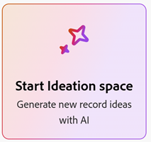
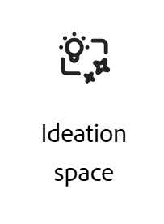

# Introdução ao espaço de ideação para o Adobe Workfront Planning

<!--
Should we add a new Feature to ExL for "Strategic Ideation"?
-->

<!--
information in this article come from this document, in addition to my notes for this project up to August 31, 2026:
https://adobe-my.sharepoint.com/:w:/r/personal/alinaw_adobe_com/_layouts/15/Doc.aspx?sourcedoc=%7B513DE769-B70B-4040-8C9E-6A9B8E3167BB%7D&file=getting-started-catalyze.docx&action=default&mobileredirect=true
-->

As informações nesta página se referem a funcionalidades que ainda não estão disponíveis. Ele está disponível somente como parte do programa **Espaço de ideação Beta**. \

{{planning-important-intro}}

O espaço Adobe Ideation é o recurso de ideação estratégica alimentado por IA da Adobe, integrado diretamente ao Workfront Planning. Ele oferece às equipes de marketing um ponto de partida estruturado e informado por dados para a estratégia de campanha, substituindo a pesquisa e a adivinhação manuais por resumos gerados por IA com base no histórico de desempenho real de uma organização.

Acessível somente pelo Workfront Planning ou pelo Menu principal do Workfront, o espaço de ideação está localizado na parte frontal do ciclo de vida da campanha, antes do planejamento, da produção e do delivery, e se alimenta diretamente no espaço de trabalho do Workfront Planning, onde as equipes planejam e executam seu trabalho.

Os espaços de ideação usam o Enterprise CX Coworker para gerar resumos que podem ser convertidos posteriormente em registros do Planning ou baixados como PDFs.

## Disponibilidade do produto

A linha do tempo de lançamento planejada para o espaço de ideação que está sujeito a alterações inclui os seguintes marcos:

* **Beta fechado:** lançado em julho de 2026, para um pequeno número de clientes.
* **Abrir Beta:** Direcionado para novembro de 2026. Essa será uma oferta de aceitação, em que os clientes devem ativar e configurar ativamente a opção, em vez de recusar ativamente a participação.
* **Disponibilidade geral:** direcionada para 2027.

## Requisitos do produto

É possível acessar o espaço de ideação se sua organização e você tiverem acesso aos seguintes produtos:

* Adobe Workfront com o Workfront Planning
* Enterprise CX Coworker

  >[!IMPORTANT]
  >
  >No momento, o CX Enterprise Coworker não está disponível para organizações nos setores de assistência médica, financeiro ou de alguns outros setores com dados confidenciais. O Assistente de IA está disponível para essas organizações, mas o espaço de ideação não está disponível para clientes do Workfront que não têm o CX Coworker.

Dependendo do acesso ao espaço de ideação, é necessário ter acesso aos seguintes pacotes:

* Durante a versão do Open Beta, você deve ter o seguinte:

  * Um pacote de fluxo de trabalho do Adobe Workfront com um pacote do Workfront Planning

* Após a versão de Disponibilidade Geral, você poderá ter uma das seguintes opções:

  * Um pacote de fluxo de trabalho do Adobe Workfront com um pacote do Workfront Planning
  * Um produto Adobe Workfront Planning como independente

>[!NOTE]
>
>O espaço de ideação só pode ser acessado no Menu principal do Workfront ou no Workfront Planning. Não é necessário um logon separado para acessar o espaço de ideação. Ela estará disponível imediatamente se você puder fazer logon no Workfront.

Para obter mais informações sobre o acesso necessário para usar o espaço de ideação, consulte [Acesso necessário para usar o espaço de ideação](/help/quicksilver/planning/ideation/access-needed-to-use-ideation-space.md).

<!--not required anymore: * Adobe GenStudio for Performance Marketing-->

<!-- only required for closed beta, see below: * Adobe Customer Journey Analytics-->

<!--
No longer required or recommended, per Et:

In addition to above requirements, you must also meet the following criteria to participate in the Closed Beta program: 

* Have an active Adobe Customer Journey Analytics (CJA) account with campaign tracking in place
* Have multi-channel campaigns with a repeatable planning process
* Actively use Workfront Planning for marketing operations
* Have at least one identified strategist or ideation user who will be the primary Ideation space user
-->

## Público-alvo e casos de uso

O espaço de ideação foi projetado para profissionais de marketing de produtos e marcas responsáveis por definir a estratégia da campanha e produzir resumos da campanha.

<!--
Too much: 

| Role | Primary job to be done |
|---|---|
| Brand Marketer | Identify messaging, trends, and cultural shifts that resonate with target audiences |
| Product Marketer | Launch insight-driven, culturally relevant campaigns that deliver business impact |
| Collaborators | Internal creative studios, external agencies, media planners/managers, and executives who need visibility into strategic direction |
-->

Como um gerenciador de espaço de trabalho, você pode usar o Espaço de ideação para criar registros no Workfront Planning seguindo as seguintes etapas:

* Crie um breve no espaço Ideação depois de iniciá-lo no Planning, conforme você começa a criar ou editar registros.
* Use os prompts de IA para coletar detalhes de outros registros no seu sistema ou da Web e finalizar a criação de resumos de ideação.
* Crie tipos de registro do Planning a partir dos resumos.
* Refine seus resumos de ideação e atualize os tipos de registro existentes no Planning.

Veja a seguir casos de uso para saber como usar o Espaço de ideação:

* **Atualizar uma campanha anterior usando o desempenho histórico**

  * Por exemplo, você pode atualizar campanhas existentes para um novo trimestre, temporada ou momento do produto.
  * Isso produz um &quot;resumo delta&quot; com base em um desempenho anterior, descrevendo o que permanece, quais alterações e por quê.

* **Criar uma nova campanha usando o desempenho histórico**

  * Por exemplo, você pode criar uma campanha ao iniciar um novo produto, segmento ou iniciativa sem um histórico de campanha direto.
  * Isso produz um resumo novo por meio da ideação guiada, uma combinação de canais recomendada e o conceito inicial ou as direções da mensagem.

## Visão geral do espaço de ideação

O espaço de ideação é uma ferramenta colaborativa de ideação de marketing estratégica para profissionais de marketing de marca e produto que criam campanhas mais robustas com mais rapidez e melhor alinhamento de equipes. Ele fundamenta as sugestões de IA em um contexto de marketing real — resumos passados, dados de desempenho, insights de público-alvo, diretrizes da marca e ativos de campanha existentes — de modo que os resultados são relevantes, não genéricos.

A seguir estão alguns exemplos de como aproveitar ao máximo sua ideação ao criar resumos:

* Fazer upload de documentos ou insights de escuta social
* Acessar o conteúdo da Web pertinente ao resumo que você está criando
* Definir uma meta de campanha
* Obter um resumo dos insights do público
* Gerar personalidades de público
* Mensagens de campanha de ideias
* Trabalhe em uma tela visual grande, usando prompts de IA para gerar texto, imagem, arquivo, gráfico e cartões insight
* Organize, revise e expanda cartões para eventualmente traduzi-los em resumos de campanha
* Colabore com vários usuários que podem adicionar ideias, deixar comentários em itens específicos da tela ou usar notas adesivas para ideias de forma livre antes que um resumo seja finalizado
* Recomendamos as seguintes práticas recomendadas ao usar o espaço de ideação:

  * **Seja específico**. Descrições de campanha mais ricas produzem cartões mais relevantes e com melhor base.
  * **Verifique antes de finalizar**. As respostas geradas por IA podem ser imprecisas, portanto, sempre verifique **Fontes** em um cartão e confirme em relação às fontes vinculadas antes de finalizar um registro.
  * **Misture cartões de IA com registros reais**. Arraste e solte registros reais no espaço de ideação.

## Obter acesso ao espaço de ideação

Para obter acesso ao espaço de ideação:

1. Verifique se você atende aos requisitos do produto conforme descrito na seção [Requisitos do produto](#product-requirements) deste artigo.
1. Entre em contato com seu representante de conta da Adobe para expressar interesse em participar do Closed Beta ou associar-se ao Open Beta, quando ele estiver disponível.
1. (Recomendado) Identifique a primeira campanha: uma recente para atualizar ou uma nova iniciativa para criar do zero.

Para obter mais informações sobre como usar o espaço de ideação, consulte também os seguintes artigos:

* [Acesso necessário para usar o espaço de ideação](/help/quicksilver/planning/ideation/access-needed-to-use-ideation-space.md)
* [Criar registros do Planning a partir de resumos de espaço de ideação](/help/quicksilver/planning/ideation/create-records-in-ideation-space-for-planning.md)
* [Criar resumos no espaço de ideação](/help/quicksilver/planning/ideation/create-briefs-in-ideation-space.md)

## Localize o espaço de ideação

Depois de garantir o acesso aos produtos, pacotes e sistema adequados e ao nível de acesso configurado, é possível localizar o espaço de ideação nas seguintes áreas do Workfront:

* Ao adicionar manualmente um novo registro no Workfront Planning

  
* No menu principal do Workfront, abrindo a área Espaço de ideação

  

  >[!TIP]
  >
  >Não é possível remover a área Espaço de ideação do menu Principal usando um modelo de layout. Se quiser que os usuários não tenham acesso ao espaço de ideação, ative a configuração Desativar espaço de ideação no nível de acesso, conforme descrito no [Acesso necessário para usar O espaço de ideação](/help/quicksilver/planning/ideation/access-needed-to-use-ideation-space.md).

## Objetos gerados pelo espaço de ideação

Você pode usar o espaço de ideação para debater e formular ideias que poderão ser convertidas posteriormente em itens importantes para o seu fluxo de trabalho.

O espaço de ideação pega todas as suas ideias e informações de fontes internas ou externas (Web) e cria um resumo. Depois de decidir que o resumo está concluído, você pode exportá-lo para os seguintes arquivos ou objetos:

* Um dos seguintes formatos de arquivo: PDF, Word, PowerPoint, modelo do PowerPoint
* Um registro do Planning

  É possível exportar um resumo para um registro de Planejamento somente quando você acessa o espaço de Ideação do Workfront Planning ou quando você conecta anteriormente um registro de Planejamento a um resumo de Ideação.

## Espaço de ideação e a Adobe CX Enterprise Coworker

O espaço de ideação usa o CX Enterprise Coworker do Adobe como sua interface de prompt.

Os usuários podem fazer perguntas de acompanhamento e refinar um breve diálogo em vez de obter um único resultado instantâneo.

Quando um resumo é vinculado a uma conexão ativa do Workfront Planning, o Colaborador impede a substituição para que o plano subjacente permaneça intacto. <!--Et to check on this, it might be overwritten. -->

<!--
**************** CONSIDER INCLUDING THIS INFORMATION FROM JESH BARLOW ABOUT COWORKER IN CATALYZE?? - https://adobecorpdev.slack.com/archives/C091C0Y735W/p1788917610365089?thread_ts=1788917251.550099&cid=C091C0Y735W

Catalyze Coworker needs — panel inside Catalyze, not a rail from Unified ShellWhy this matters. Catalyze is AI-first. You can't use it without a prompt, so the prompting surface can't be something you open and close from Unified Shell. Coworker's rail was built to bolt onto apps that already work fine without AI. We need the opposite.

What we need

* Coworker embedded as a panel inside Catalyze (the Photoshop/Illustrator model), always present, minimized or expanded, never fully closeable.
* Not the Unified Shell rail that slides in, pushes the app, and only opens and closes from the shell.
* Quick terminology flag, since Coworker inverts it. By "panel" we mean embedded in the app. Their team uses "panel" for the shell version, so we have to be explicit every time.

Must-haves

* Minimized and expanded prompt bar states that live inside Catalyze, not tied to the shell.
* Minimize, never close. There's no state where the prompt disappears.
* Full UI control over how the prompt behaves.
* Headless Coworker so the panel can always sit on the canvas.

Where it stands (Aug 20 Shell/Catalyze sync with Stephen Gould)

* Headless is technically possible. Coworker can be hosted in Catalyze's own front-end.
* But Horia's team has no capacity to build or own an in-app rail. Deeper embedding means Catalyze eng builds the panel and owns it going forward.
* The open question is ownership, one-time integration vs owning the panel long-term. Still unresolved, and it's the thing that decides this.

Worth noting

* Experience Workspace and Brand Visibility (AM) already run Coworker without the shell, so headless isn't net-new. Let's learn how they did it before anyone calls it infeasible.
* Next step everyone agreed on is getting clarity from Horia's team and Joshua on rail ownership.

*************************************
-->

## Recursos adicionais

* [Planejamento de campanha do Adobe Workfront](https://business.adobe.com/br/products/workfront/campaign-planning.html)
* [Documentação de planejamento do Adobe Workfront](/help/quicksilver/planning/planning-information.md)
* [Visão geral do Adobe GenStudio](https://business.adobe.com/br/products/genstudio.html)
* [Adobe Customer Journey Analytics](https://business.adobe.com/br/products/adobe-analytics/customer-journey-analytics.html)

<!--

Not sure if we should disclose this: 

## The problem the Ideation space solves

Before the Ideation space, campaign strategy relied on two slow, manual processes:

- **Gathering insights** — fragmented, time-consuming, and difficult when no prior audience data exists
- **Aligning stakeholders** — without a shared, data-backed "hook," executives, creatives, and channel partners often work from different assumptions, causing rework and delays

The Ideation space automates insight synthesis and generates a structured brief that gives everyone a shared starting point.
-->

<!--
## What's included, phase by phase

| Phase | Timeline | What's included |
|---|---|---|
| Closed Beta | July 2026 | Limited customers/users/campaigns; core agent skills (strategy framing, messaging ideation, audience definition, data ingestion, brief generation); CJA data integration |
| Open Beta | ~Sept 2026 (planned) | Quality/performance improvements; CJA integration refinements; Workfront Planning handoff; data visualization; Planning workspace structure ingestion; Unity/Conversational UI integration |
| General Availability | H2 2026 (planned) | Bring Your Own Data Source (BYODS); Workfront/Workfront Planning data integration; audience data integration; social data integration; workflow ingestion; strategy testing capabilities |

At GA, the Ideation space is also expected to be accessible through the GenStudio Home conversational UI, running as part of Adobe's Agent Orchestrator suite of agents.
-->