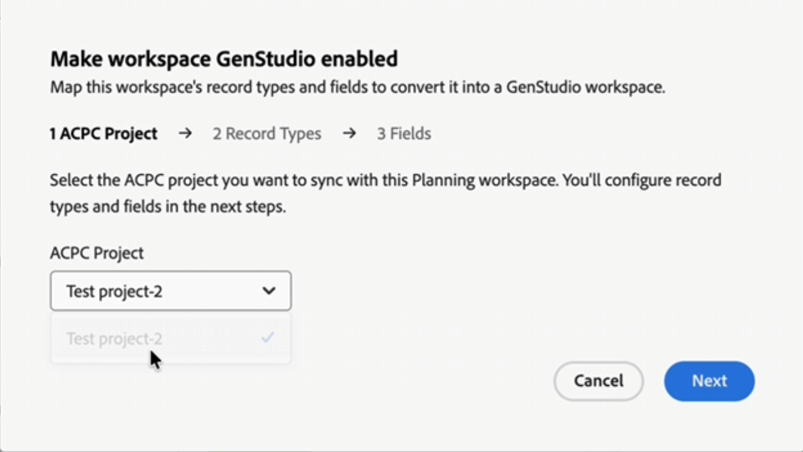

# Ativar um espaço de trabalho do Workfront Planning para o GenStudio for Performance Marketing

{{planning-important-intro}}

<!-- THIS IS HIDDEN FROM TOC-->

<!--
Better metadata, at publishing:
---
title: Promote a Workfront Planning workspace to GenStudio
description: The GenStudio for Performance Marketing workspace is available in Adobe Workfront Planning when your company has purchased both products and your instance of Workfront is integrated with your company's instance of GenStudio. You can promote a Workfront Planning workspace to GenStudio and have its information visible and updated from both systems.
role: User, Admin
author: Alina
recommendations: noDisplay, noCatalog
---
-->
Além do Workfront Planning, se sua empresa também comprou o Adobe GenStudio for Performance Marketing, o espaço de trabalho do GenStudio estará disponível no Adobe Workfront Planning quando sua instância do Workfront for integrada à instância do GenStudio da sua empresa.

Se você já tiver um espaço de trabalho no Workfront Planning, poderá habilitá-lo para o GenStudio em vez de recriar seus dados.

A ativação de um espaço de trabalho o vincula a um projeto de armazenamento do Adobe e mapeia seus tipos de registro e campos para o esquema do espaço de trabalho do GenStudio. Após concluir a configuração, você pode abrir os registros do espaço de trabalho no GenStudio.

Considere o seguinte:

* Você deve ter acesso ao Workfront Planning e ao GenStudio for Performance Marketing.
* Você deve ter um projeto do Adobe Cloud Storage para vincular ao espaço de trabalho. Um administrador de organização pode criar um na Adobe Admin Console.

  Para obter informações, consulte [Gerenciar armazenamento do Adobe](https://helpx.adobe.com/br/business/enterprise/manage-storage-assets/manage-storage/manage-adobe-storage.html). <!--ensure this site still works-->

## Ativar um espaço de trabalho do Workfront Planning para o GenStudio

1. No Workfront Planning, abra o espaço de trabalho que deseja ativar.
1. Clique no menu **Mais**  à direita do nome do espaço de trabalho e clique em **Habilitar GenStudio**.

   A caixa **Criar espaço de trabalho habilitado para GenStudio** é aberta com as seguintes etapas:

   1. **Projeto ACPC**: selecione o **Projeto ACPC** (projeto Adobe cloud storage) que deseja sincronizar com este espaço de trabalho e clique em **Avançar**. Os usuários acessam o espaço de trabalho no GenStudio por meio deste projeto.

      

   1. **Tipos de registro**: mapeie os tipos de registro do espaço de trabalho para os seis tipos de registro exigidos pela GenStudio:

      * Campanhas
      * Produtos
      * Personas
      * Canais
      * Regiões
      * Ativações

      Para cada um, abra a lista e selecione o tipo de registro correspondente do Planning ou selecione **Adicionar novo** para criá-lo e clique em **Avançar**.

      

   1. **Campos**: mapeie os campos para cada tipo de registro. Use as guias na parte superior da caixa de diálogo para se mover entre tipos de registro. Para cada campo, selecione o campo correspondente do Planning ou selecione **Adicionar novo** para criá-lo.

      Repita a configuração de campo para todos os tipos de registro.

      

   1. Analise e resolva quaisquer avisos.

      Por exemplo, um novo campo pode se tornar o campo principal do tipo de registro ou um alias de campo que já está em uso é renomeado (se você já tiver um campo chamado &quot;Regiões&quot;, o campo importado pode se tornar &quot;Regiões 2&quot;).

      Mapear um campo **Status** adiciona as opções necessárias.

   1. Clique em **Publicar**.

      Uma mensagem de confirmação é exibida quando o espaço de trabalho é ativado. Os tipos de registro mapeados são marcados no espaço de trabalho.

      Os tipos de registro mapeados para serem acessíveis pelo GenStudio têm um novo ícone **Adobe** em seus cartões.

      

1. Abra o GenStudio, selecione **Campanhas** e clique no **projeto ACPC** que você configurou originalmente para esta configuração no canto inferior esquerdo da tela. Revise os tipos e campos de registro importados.

   >[!TIP]
   >
   >Você vê apenas os registros permitidos pela associação ao projeto ACPC.
