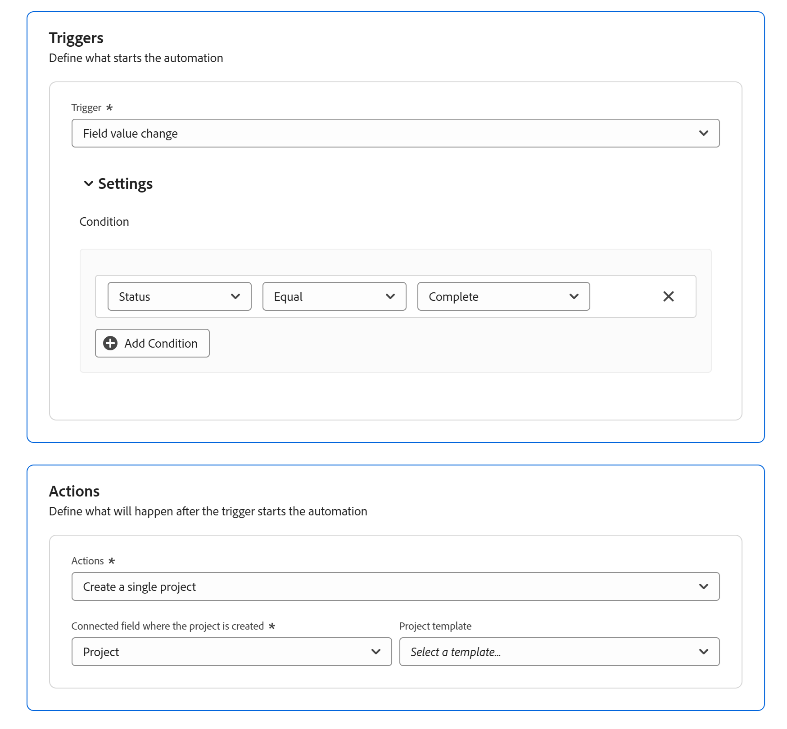
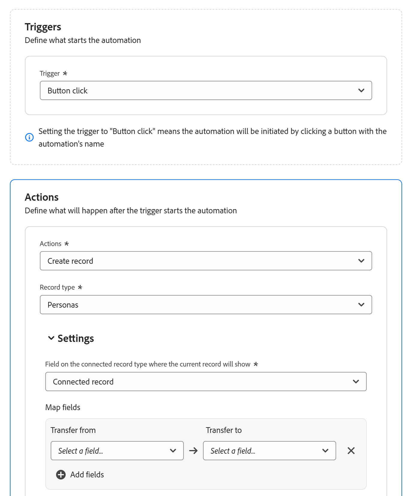
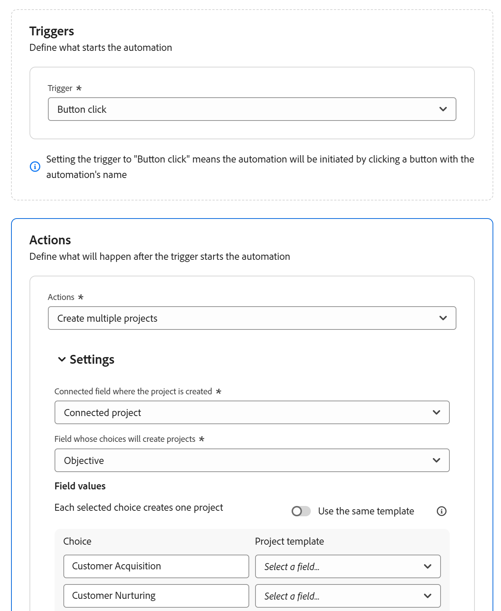

# Configurar automações do Planejamento do Adobe Workfront

<!--
The highlighted information on this page refers to functionality not yet generally available. It is available only in the Preview environment for all customers. After the release to Preview, the same features are also available monthly in the Production environment for customers who enabled fast releases.    

For information about fast releases, see [Enable or disable fast releases for your organization](/help/quicksilver/administration-and-setup/set-up-workfront/configure-system-defaults/enable-fast-release-process.md). 
-->

<!--add screen shots when UI is finalized AND redo all the steps - some things got changed and moved around-->

<!--you might need to add something about notifications and emails?!-->
<!--add a new section to this article to mention a new way to create objects: help/quicksilver/planning/records/create-records.md-->
<!-- add a new section to this article to mention a new way to create WF objects from Planning: help/quicksilver/planning/records/create-workfront-objects-from-workfront-planning.md-->

<!-- if they give access to use the automation to people with LESS than Manage permissions to a workspace, split this article in two: the Configure section should be for admins and the "Use a Workfront Planning automation to create an object" should be for all other users-->

{{planning-important-intro}}

Você pode configurar automações no Adobe Workfront Planning que, quando ativadas, criam objetos no Workfront ou registros no Workfront Planning quando acionadas a partir de um registro do Planning. Os objetos ou registros criados são conectados automaticamente aos registros dos quais você está acionando a automação.

Você pode configurar e ativar a automação na página do tipo de registro no Workfront Planning.

Por exemplo, você pode criar uma automação que use uma campanha do Workfront Planning e crie um projeto no Workfront para rastrear o progresso dessa campanha.

Este artigo descreve como gerenciar automações, incluindo como editá-las, desativá-las, excluí-las e acioná-las para criar objetos e registros.

Para obter informações sobre como criar registros ou objetos usando uma automação existente, consulte [Criar objetos usando as automações de registro do Adobe Workfront Planning](/help/quicksilver/planning/records/create-wf-objects-using-planning-automations.md).

## Requisitos de acesso

+++ Expanda para exibir os requisitos de acesso para a funcionalidade neste artigo. 

<table style="table-layout:auto"> 
<col> 
</col> 
<col> 
</col> 
<tbody> 
    <tr> 
<tr> 
</tr>   
<tr> 
   <td role="rowheader">
Pacote do Adobe Workfront
</td> 
   <td> 

Qualquer Workfront ou Fluxo de trabalho com um pacote do Planning
 
Ou

Qualquer pacote do Planning quando adquirido como um pacote independente

</td> 
  <tr> 
   <td role="rowheader">
Licença do Adobe Workfront
</td> 
   <td>
Workflow Standard

   </td> 
  </tr> 
  <tr> 
   <td role="rowheader">
licença do Adobe Planning
</td> 
   <td>
Planejamento padrão

   
O administrador do sistema terá acesso para configurar automações com base na alteração do valor do campo

   </td> 
  </tr>
  <tr> 
   <td role="rowheader">
Configuração do nível de acesso
</td> 
   <td> 
Você deve adicionar um Workflow e um tipo de licença do Planning ao nível de acesso quando tiver um Workflow e um pacote do Planning
   
</td> 
  </tr>
  <tr> 
   <td role="rowheader">
Permissões de objeto
</td> 
   <td> 
Gerencie permissões para o espaço de trabalho e para o tipo de registro em que deseja criar automações. 

   
Os administradores do sistema têm permissões de gerenciamento para todos os espaços de trabalho, incluindo aqueles que não criaram

   
Os criadores de automação têm permissões de gerenciamento para suas próprias automações

   
Você precisa de permissões Editar ou superiores para a automação para editá-la, e permissões Executar para executá-la

   </td> 
  </tr>  
</tbody> 
</table>

Para obter mais informações sobre requisitos de acesso do Workfront, consulte [Requisitos de acesso na documentação do Workfront](/help/quicksilver/administration-and-setup/add-users/access-levels-and-object-permissions/access-level-requirements-in-documentation.md).

+++   

<!--
Old:
<table style="table-layout:auto"> 
<col> 
</col> 
<col> 
</col> 
<tbody> 
    <tr> 
<tr> 
<td> 
   
 Products
 </td> 
   <td> 
   <ul><li>
 Adobe Workfront
</li> 
   <li>
 Adobe Workfront Planning
</li></ul></td> 
  </tr>   
<tr> 
   <td role="rowheader">
Adobe Workfront plan*
</td> 
   <td> 

Any of the following Workfront plans:
 
<ul><li>Select</li> 
<li>Prime</li> 
<li>Ultimate</li></ul> 

Workfront Planning is not available for legacy Workfront plans
 
   </td> 
<tr> 
   <td role="rowheader">
Adobe Workfront Planning package*
</td> 
   <td> 

Any 
 

For more information about what is included in each Workfront Planning plan, contact your Workfront account manager. 
 
   </td> 
 <tr> 
   <td role="rowheader">
Adobe Workfront platform
</td> 
   <td> 

Your organization's instance of Workfront must be onboarded to the Adobe Unified Experience to be able to access Workfront Planning.
 

For more information, see <a href="/help/quicksilver/workfront-basics/navigate-workfront/workfront-navigation/adobe-unified-experience.md">Adobe Unified Experience for Workfront</a>. 
 
   </td> 
   </tr> 
  </tr> 
  <tr> 
   <td role="rowheader">
Adobe Workfront license*
</td> 
   <td> Standard
   
Workfront Planning is not available for legacy Workfront licenses
 
  </td> 
  </tr> 
  <tr> 
   <td role="rowheader">
Access level configuration
</td> 
   <td> 
You must add both a Workflow and a Planning license type to the access level when you have both a Workflow and a Planning package
 
   
Edit access with access to Create objects in Workfront for the object types that you want to create (projects, portfolios, programs). 
  
</td> 
  </tr> 
<tr> 
   <td role="rowheader">
Object permissions
</td> 
   <td> 
Manage permissions to the workspace and to the record type where you want to create automations. 

   
System Administrators have Manage permissions to all workspaces, including the ones they did not create

   </td> 
  </tr> 
</tbody> 
</table>
-->

## Configurar uma automação no Workfront Planning

Você deve configurar uma automação para um tipo de registro no Workfront Planning antes de usá-la para criar objetos.

{{step1-to-planning}}

1. Clique em um cartão de tipo de registro e no nome de um registro.

   A página de tipo de registro é aberta.
1. Clique no menu **Mais**  à direita do nome do tipo de registro e clique em **Gerenciar automações**.

   A lista de automações disponíveis para o tipo de registro selecionado é aberta.

1. Clique em **Nova automação** no canto superior direito da tela. A caixa **Nova automação** é aberta.
1. Atualize os seguintes campos:

   * Substitua **Automação sem título** pelo texto que você deseja que apareça no botão de automação. Os usuários clicarão nesse botão ao usar a automação para criar um objeto do Workfront ou um registro do Planning.
   * **Descrição**: adicione uma descrição para identificar a finalidade da automação.
1. Clique em **Salvar**.
A página de detalhes da automação é aberta.

1. Na página de detalhes da automação, selecione uma das seguintes opções na seção **Triggers**:

   * **Acionador**: selecione uma ação que acionará a automação:

     * Clique no botão
     * Alteração do valor do campo

1. (Condicional) Se você selecionou **Botão clicar**, vá para a etapa 9 abaixo que descreve a área **Ações**. <!--ensure this number stays accurate-->

1. (Condicional) Se você selecionou **Alteração do valor do campo**, faça o seguinte na seção **Configurações**:

   1. Escolha um campo no menu suspenso. Esses são campos associados ao tipo de registro selecionado.
   1. Continue definindo condições para o campo selecionado.
   1. Clique em **Adicionar condição** para adicionar até 5 campos e definir sua condição.

      Você pode adicionar qualquer um dos seguintes tipos de campos:

      * Seleção única
      * Seleção múltipla
      * Texto de linha única
      * Parágrafo
      * Número
      * Caixa de seleção
      * Data

      O Workfront Planning criará objetos automaticamente quando as condições forem atendidas.

      

      >[!IMPORTANT]
      >
      >* O modificador em cada condição é alterado com o tipo de campos que você seleciona.
      >* Cada condição pode fazer referência a um ou mais valores. Em todas as condições, você pode fazer referência a um máximo de 5 valores totais, independentemente de quantas condições você criar. Por exemplo, uma configuração com 3 condições que referenciam coletivamente 6 valores excede o limite. As condições não podem ser aninhadas. Se sua configuração exceder o limite de 5 valores, um erro em linha aparecerá abaixo das condições e você não poderá salvar a automação até reduzir o número de valores referenciados.
      >
      >   Se você precisar de mais condições do que o limite permite, divida o trabalho em duas automações separadas.
      >
      >   Para obter mais informações, consulte [Uso de grupos de filtros](/help/quicksilver/wf-api/general/event-subs-api.md#using-filter-groups) no artigo Assinaturas de eventos.

1. Atualizar os seguintes campos na seção **Ações**: <!--submitted bugs for these fields - see if they need changing here-->
   * **Ações**: selecione a ação que você deseja que o Workfront execute ao acionar a automação. Este campo é obrigatório.
     Selecione uma das seguintes ações:

     * Criar vários projetos
     * Criar um projeto único
     * Criar projeto
     * Criar registro
     * Criar programa
     * Criar portfólio
     * Criar grupo

     >[!TIP]
     >
     >Depois de salvar a automação, não é mais possível alterar a ação selecionada nesse campo.

1. (Condicional) Dependendo da ação selecionada, atualize os seguintes campos:

   * **Criar um único projeto**: <!--replace to the left: Create a single project-->
     * **Campo conectado onde o projeto é criado**: este é o campo conectado onde o novo projeto será exibido. Este campo é obrigatório.
     * **Modelo de projeto**: selecione um modelo de projeto que a Workfront usará para criar o projeto.

   * **Criar vários projetos**:
     * **Campo conectado onde o projeto é criado**: este é o campo conectado onde o novo projeto será exibido. Este campo é obrigatório.
     * **Campo cujas opções criarão os registros**: escolha um campo de seleção única ou múltipla do tipo de registro selecionado. O Workfront cria um projeto para cada opção de campo atualmente selecionada no registro de onde você aciona a automação.

     >[!TIP]
     >
     >Um projeto é criado apenas para as opções atualmente selecionadas no campo de seleção múltipla ou única do registro a partir do qual você está executando a automação, e não para todas as opções possíveis para esse campo.
     >

     * **Usar o mesmo modelo**: selecione esta opção para usar o mesmo modelo para cada novo projeto. Se a opção estiver desmarcada, selecione um **Modelo de projeto** para cada escolha de campo.
     * **Modelo de projeto**: se você selecionou a opção **Usar o mesmo modelo**, selecione um modelo de projeto que a Workfront usará para criar os projetos.

   * **Criar portfólio**:
     * **Campo conectado onde o portfólio é criado**: este é o campo conectado onde o novo portfólio será exibido. Este campo é obrigatório.
     * **Formulário personalizado para anexar ao novo portfólio**: selecione um formulário personalizado para anexar ao novo portfólio. Você deve criar um formulário personalizado do portfólio antes de selecioná-lo.
   * **Criar programa**:
     * **Campo conectado onde o programa é criado**: este é o campo conectado onde o novo programa será exibido. Este campo é obrigatório.
     * **Portfólio de programas**: selecione um portfólio onde o novo programa será adicionado. Este campo é obrigatório.
     * **Formulário personalizado para anexar ao novo programa**: selecione um formulário personalizado para anexar ao novo programa. Você deve criar um formulário personalizado de programa antes de selecioná-lo.
   * **Criar grupo**:
     * **Campo conectado onde o grupo é criado**: este é o campo conectado onde o novo grupo será exibido. Este campo é obrigatório.
     * **Formulário personalizado para anexar ao novo grupo**: selecione um formulário personalizado para anexar ao novo programa. Você deve criar um formulário personalizado de programa antes de selecioná-lo.
   * **Criar registro**:
     * **Tipo de registro**: selecione o tipo de registro que deseja criar.

       A subseção **Settings** é exibida. Atualize os seguintes campos na subseção **Configurações**:

       * **Campo no tipo de registro conectado onde o registro atual será exibido**: este é o campo conectado no tipo de registro selecionado para a ação onde o registro atual será exibido.

       Por exemplo, se estiver criando uma automação para que as campanhas conectem registros de Produto do, esse será o campo conectado no tipo de registro de Produto em que as campanhas serão exibidas, depois que os produtos forem criados usando a automação.

       Este campo é obrigatório.

       <!--submitted a change in functionality and UI text for this - revise??-->
                                                                                 Na área **Mapear campos**, atualize as seguintes informações:

       * **Transferir de**: selecione campos do tipo de registro para o qual a automação é criada para mapeá-los para os campos do tipo de registro conectado.
       * **Transferir para**: selecione campos do registro recém-criado que serão preenchidos com informações do registro a partir do qual você está executando a automação.

       >[!TIP]
       >
       >* Os tipos de campo do tipo de registro original devem corresponder aos tipos de campo do tipo de registro recém-criado.
       >* Se você não escolher nenhum campo, os nomes dos novos registros serão **Registro sem título**.

1. (Opcional e condicional) Se você optou por criar um registro, clique em **Adicionar campos** para mapear campos de pesquisa adicionais de um registro para outro.
1. (Condicional) Se não houver campos de conexão entre o tipo de registro original e o tipo de registro selecionado no campo **Tipo de registro**, clique em **Adicionar campo conectado**.

   

   Os dois campos a seguir são criados:

   * Um novo campo de conexão chamado **Registro conectado** é criado para o tipo de registro indicado no campo **Tipo de registro**.
   * Um novo campo de conexão com o mesmo nome que o indicado no campo **Tipo de registro** é criado para o tipo de registro para o qual você está configurando a automação.

     Por exemplo, se você estiver configurando uma automação para que o Campaigns crie automaticamente outro tipo de registro chamado Marcas e clicar em **Adicionar campo conectado**, os seguintes campos serão criados:

     * O campo de conexão **Registro conectado** foi criado para o tipo de registro **Marcas**.
     * O campo de conexão **Marcas** é criado para o tipo de registro **Campanhas**.

1. (Opcional) Se não houver campos de conexão entre o tipo de registro original e o objeto do Workfront selecionado na área Ações, clique em **Adicionar campo conectado**.

   

   Os itens a seguir são criados:

   * Um novo campo de conexão chamado **Conectado &lt; nome do objeto Workfront >** é criado para o tipo de registro para o qual você criou a automação. Por exemplo, um campo **Projeto conectado** é criado para o tipo de registro para o qual você está criando a automação, quando você opta por criar projetos automaticamente.
   * Um novo cartão de tipo de registro é adicionado à seção Planejamento de um projeto do Workfront, no Workfront, com o nome do tipo de registro para o qual você está configurando a automação.

1. Clique em **Salvar** no canto superior direito da página de detalhes de automação.

   A automação é exibida na lista de automações e está disponível para uso em registros.

## Gerenciar automações existentes

{{step1-to-planning}}

1. Clique em um cartão de tipo de registro e no nome de um registro.

   A página de tipo de registro é aberta.
1. Clique no menu **Mais**  à direita do nome do tipo de registro e clique em **Gerenciar automações**.

   A lista de automações disponíveis para o tipo de registro selecionado é aberta.

1. (Opcional) Para exibir, desabilitar ou excluir uma automação de uma lista de automações, clique no menu **Mais**  à direita do nome de uma automação e siga um destes procedimentos:

   * Para uma automação de alteração de valor de campo, clique em **Exibir** para exibir as configurações de automação.

     >[!TIP]
     >
     >Não é possível editar as configurações de uma automação depois que elas tiverem sido salvas, quando a automação é acionada por uma alteração de valor de campo.

   * Em uma automação clicada com o botão, clique em **Editar** para atualizar as seguintes informações:

     * O nome da automação, clicando no menu **Mais**  à direita do nome da automação e em **Editar**.
     * Qualquer campo na automação, exceto o campo **Ações**.

     >[!TIP]
     >
     >Não é possível alterar a ação originalmente selecionada para uma automação.

   * Clique em **Desabilitar** para remover a automação da exibição de tabela do registro e impedir que os usuários a utilizem para criar registros ou objetos.

     Os registros que foram criados usando uma automação desativada permanecem conectados ao registro selecionado originalmente.

     Para torná-lo disponível novamente, clique novamente no menu **Mais**, no menu , depois clique em **Ativar**.
   * Clique em **Excluir** para excluir a automação. Uma automação excluída não pode ser recuperada.

     Os registros que foram criados usando uma automação excluída permanecem conectados ao registro selecionado originalmente.

## Compartilhar automações

Como criador de uma automação, você tem Permissões de gerenciamento para ela, por padrão.

Além disso, você pode compartilhá-lo com outros usuários ou equipes.

Por padrão, os usuários que fazem parte do espaço de trabalho não obtêm permissões para as automações no espaço de trabalho. Você deve compartilhar especificamente uma automação com eles.

1. Vá para o tipo de registro cujas automações você deseja compartilhar.
1. Clique no menu **Mais** à direita do nome do tipo de registro e clique em **Automações**.

   Uma lista de automações é aberta.
1. (Condicional) Se não houver automação na lista, crie uma, conforme descrito na seção [Configurar uma automação no Workfront Planning](#configure-an-automation-in-workfront-planning) deste artigo.
1. Na lista de automações, clique no menu **Mais** à direita do nome da automação e clique em **Compartilhar**.
1. Na caixa de compartilhamento, comece digitando o nome dos usuários ou equipes com os quais deseja compartilhar. <!--checking with Mikayel if the other entities are not available for sharing for automations-->
1. Escolha entre os seguintes níveis de permissão de compartilhamento:

   | Nível de permissão | Ações permitidas |
   | --- | --- |
   | **Gerenciar** | Pode excluir, editar, iniciar e visualizar a automação |
   | **Editar** | Pode editar, iniciar e visualizar a automação |
   | **Executar** | Pode iniciar e visualizar a automação |

1. Para alterar as permissões de um usuário existente, abra a mesma caixa de diálogo e selecione um nível de permissão diferente na lista suspensa ao lado do nome do usuário ou clique em Remover para revogar todo o acesso.
1. Clique em **Salvar** para salvar as alterações de compartilhamento.

<!--checking this with Mikayel Aleksanyan to be sure-->

<!-- 
original info sent in slack from Mikayel: 
Update the [Workfront Planning automations documentation](https://experienceleague.adobe.com/pt-br/docs/workfront/using/adobe-workfront-planning/adobe-workfront-planning-records/configure-automations-to-create-records) to explain the change from automatic sharing to explicit, owner-controlled sharing.

Feature overview

Previously, newly created automations were automatically shared with everyone in the Workfront Planning workspace. Now, a new automation is available only to its owner by default. The owner must manually share it with other users to grant them access.

This change gives owners control over who can access their automations and what access level each user receives.

What the documentation should cover

1. Default visibility and sharing

* Previously, a newly created automation was available to everyone in its Workfront Planning workspace by default.
* With the new permission system, a newly created automation is available only to its creator/owner by default.
* Owners must explicitly share new automations with other users to grant them access; workspace membership alone does not grant access to a new automation.
* Owners can use the **Share** action to grant access to other users in the same organization. In the automations list, open the automation's **More options (···)** menu next to its name, then select **Share**.
* Sharing grants access to an automation; it does not transfer ownership.

1. Automation access levels

The sharing dialog offers the following access levels, with these descriptions:

| Access level | Allowed actions |
| --- | --- |
| **Manage** | Can delete, edit, start, and view |
| **Edit** | Can edit, start, and view |
| **Run** | Can start and view |

The automation creator is listed as **Owner**. **Remove** is an action for removing a user's access, not an access level.

1. How to share and update access

1. In the automations list, open the automation's **More options (···)** menu and select **Share**.
1. In the **Share [automation name]** dialog, use **Add people** to select the users to share with.
1. Use the access-level dropdown next to a user to assign **Manage**, **Edit**, or **Run**.
1. Click **Save** to save the sharing changes.

To change an existing user's access, open the same dialog and select a different access level from the dropdown next to their name. To revoke access, select **Remove**. Click **Save** to save the changes.

1. Existing automations

* At the introduction of the new permission system, existing automations were shared with users in their respective Workfront Planning workspaces to preserve existing access.
-->