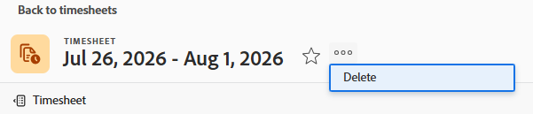

# Excluir folhas de horas no Adobe Workfront

As alterações feitas em um perfil de planilha de horas não entrarão em vigor imediatamente para as planilhas existentes, conforme explicado em [Criar, editar e atribuir perfis de planilha de horas](../../timesheets/create-and-manage-timesheets/create-timesheet-profiles.md). Para tornar as alterações visíveis em folhas de horas existentes, você deve excluir as folhas de horas que foram geradas e gerar novas. Isso se aplica somente às folhas de horas que foram geradas ao associar perfis de folha de horas a usuários.

>[!NOTE]
>
>Planilhas de horas que foram criadas manualmente não podem ser recriadas regenerando planilhas de horas, a menos que os usuários tenham sido associados a um perfil de planilha de horas desde que a planilha de horas foi criada manualmente. A exclusão de uma folha de horas criada manualmente pode causar perda de dados. Para obter informações sobre como criar uma única folha de horas, consulte [Criar uma folha de horas de uso único](../../timesheets/create-and-manage-timesheets/create-tmshts.md).

Os administradores do Adobe Workfront ou de grupo podem gerar folhas de horas para todos no sistema. Para obter mais informações sobre a geração manual de folhas de horas, consulte:

* [Gerar folhas de horas manualmente](../../timesheets/create-and-manage-timesheets/manually-generate-timesheets.md)
* [Criar e gerenciar os perfis de planilha de horas de um grupo](../../administration-and-setup/manage-groups/work-with-group-objects/create-and-modify-a-groups-timesheet-profiles.md)

>[!IMPORTANT]
>
>* Não é possível recuperar uma planilha de horas excluída.
>* Recomendamos que você não exclua folhas de horas anteriores, pois elas não são geradas automaticamente com base em perfis de folha de horas. Você pode excluir as folhas de horas atuais e futuras e gerá-las manualmente se quiser que as alterações em seus perfis de folha de horas sejam imediatamente visíveis nas novas folhas de horas.
>* Quando você exclui folhas de horas, as horas registradas em tarefas, problemas e projetos não são excluídas. Somente as Horas gerais são excluídas com a folha de horas. Em um editor de texto separado, anote quais Horas gerais estão associadas à folha de horas. Depois que a folha de horas for excluída, você pode registrá-las na nova folha de horas.
>

## Requisitos de acesso

+++ Expanda para visualizar os requisitos de acesso da funcionalidade neste artigo.

<table style="table-layout:auto">
 <col> 
 <col>
 <tbody> 
  <tr> 
   <td>Pacote do Adobe Workfront</td> 
   <td>
Qualquer
</td> 
  </tr> 
  <tr> 
   <td>Licença do Adobe Workfront</td> 
   <td>
   
Padrão

   
Plano
</td>
  </tr> 
  <tr> 
   <td>Configurações de nível de acesso</td> 
   <td>
Acesso administrativo a planilhas de horas
 </td> 
  </tr> 
 </tbody> 
</table>

Para obter informações, consulte [Requisitos de acesso na documentação do Workfront](/help/quicksilver/administration-and-setup/add-users/access-levels-and-object-permissions/access-level-requirements-in-documentation.md).

+++

## Excluir planilhas de horas em uma lista

{{step1-to-timesheets}}

Todas as planilhas de horas que você tem acesso para visualizar são exibidas por padrão.

1. (Opcional) Siga um destes procedimentos para atualizar o filtro na lista de folhas de horas:

   * Selecione **Minhas planilhas de horas aprovadas** no canto superior direito da página para exibir somente as planilhas de horas aprovadas por você,

     Ou

     Selecione **Minhas Planilhas de Horas** para exibir apenas suas planilhas de horas.

     Isso aplica os filtros **Minhas Aprovações de Planilha de Horas** ou **Minha Planilha de Horas** à lista de planilhas de horas.

   * Clique no ícone **Filtro**  para aplicar um filtro ou criar um novo filtro. Para obter informações sobre como criar ou atualizar filtros, consulte [Criar ou editar filtros no Adobe Workfront](../../reports-and-dashboards/reports/reporting-elements/create-filters.md).

   >[!NOTE]
   >
   >As opções Minhas aprovações de folha de horas e Minhas folhas de horas não são exibidas na parte superior da lista de folha de horas ou na lista de filtros se o administrador do Workfront ou um administrador de grupo removeu esses filtros dos Controles de lista na área Configuração ou do Modelo de layout. Para obter mais informações, consulte [Personalizar Filtros, Exibições e Agrupamentos usando um modelo de layout](../../administration-and-setup/customize-workfront/use-layout-templates/customize-fvg-list-controls-layout-template.md).

1. (Opcional) Clique nos ícones **Exibir**  ou **Agrupamento**  para aplicar um modo de exibição ou agrupamento ou para criar um novo.

   Para obter informações sobre como criar filtros, visualizações ou agrupamentos, consulte os seguintes artigos:

   * [Criar ou editar filtros no Adobe Workfront](../../reports-and-dashboards/reports/reporting-elements/create-filters.md)
   * [Criar ou editar exibições no Adobe Workfront](../../reports-and-dashboards/reports/reporting-elements/create-edit-views.md)
   * [Criar agrupamentos no Adobe Workfront](../../reports-and-dashboards/reports/reporting-elements/create-groupings.md)

1. Selecione uma ou várias planilhas de horas que deseja excluir e clique no ícone **Excluir**  na parte superior da lista de planilhas de horas.

1. Clique em **Excluir**.

   As folhas de horas selecionadas são excluídas e não podem ser recuperadas.

   Para gerar novas folhas de horas, verifique se os usuários estão associados a um perfil de folha de horas e peça ao administrador do Workfront ou a um administrador de grupo para gerar novas folhas de horas.

   Para obter mais informações, consulte:

   * [Criar, editar e atribuir perfis de planilha de horas](../../timesheets/create-and-manage-timesheets/create-timesheet-profiles.md)
   * [Gerar folhas de horas manualmente](../../timesheets/create-and-manage-timesheets/manually-generate-timesheets.md)
   * [Criar e gerenciar os perfis de planilha de horas de um grupo](../../administration-and-setup/manage-groups/work-with-group-objects/create-and-modify-a-groups-timesheet-profiles.md)

## Excluir uma planilha de horas da página Planilha de horas

{{step1-to-timesheets}}

1. Clique no nome da planilha de horas que deseja excluir.
1. Na folha de horas, clique no menu [!UICONTROL **Mais**]  à direita do nome da folha de horas e clique em **Excluir**.

   
1. Clique em [!UICONTROL **Excluir**] para confirmar.

   A folha de horas foi excluída e não pode ser recuperada.
