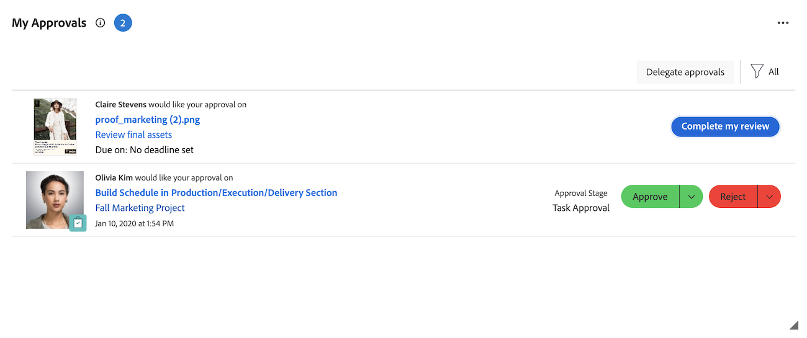

# Gerenciar aprovações com o widget Minhas aprovações

O widget Minhas aprovações exibe todas as aprovações pendentes, atribuídas, delegadas e enviadas em um único local. Aqui, você pode filtrar e organizar suas aprovações, tomar decisões e delegar aprovações conforme necessário.

O widget Minhas aprovações é compatível com aprovações dos seguintes objetos do Workfront:

* Tarefas
* Problemas
* Projetos
* Documentos
* Provas
* Solicitações de registro de planejamento
* Planilhas de horas

>[!NOTE]
>
>Se sua organização usar o Adobe Cloud Storage, uma aprovação de documento aparecerá no widget somente quando o projeto que contém o documento for compartilhado com você.

## Requisitos de acesso

+++ Expanda para visualizar os requisitos de acesso da funcionalidade neste artigo.

<table style="table-layout:auto"> 
 <col> 
 <col> 
 <tbody> 
  <tr> 
   <td role="rowheader">Pacote do Adobe Workfront</td> 
   <td> 
Qualquer
 </td> 
  </tr> 
  <tr> 
   <td role="rowheader">Licença do Adobe Workfront</td> 
   <td> 
   
Colaborador ou posterior

   
Revisar ou superior
 </td> 
  </tr> 
  <tr> 
   <td role="rowheader">Configurações de nível de acesso</td> 
   <td> 
Visualizar ou ter maior acesso aos objetos associados às aprovações
</td> 
  </tr> 
  <tr> 
   <td role="rowheader">Permissões de objeto</td> 
   <td> 
Exibir permissões ou mais altas para os objetos associados às aprovações
</td> 
  </tr> 
 </tbody> 
</table>

Para obter informações, consulte [Requisitos de acesso na documentação do Workfront](/help/quicksilver/administration-and-setup/add-users/access-levels-and-object-permissions/access-level-requirements-in-documentation.md).

+++

## Aprovar trabalho no widget Minhas aprovações

1. Clique no **[!UICONTROL Menu Principal]**  no canto superior direito e clique em **[!UICONTROL Página Inicial]**.
1. (Condicional) Clique em **Personalizar** para adicionar o widget **Minhas aprovações**.
1. (Opcional) Ajuste as opções de filtro no widget Minhas aprovações para escolher quais aprovações exibir. As seguintes opções de filtro estão disponíveis:

   | Opção Filtrar | Descrição |
   |--------|-------------|
   | Todos | Exibe todas as aprovações atribuídas a você, delegadas a você por outros usuários e enviadas por você. |
   | Minhas aprovações | Exibe as aprovações atribuídas a você. Esta é a opção padrão. |
   | Aprovações delegadas | Exibe aprovações que foram delegadas a você por outros usuários. |
   | Aprovações que enviei | Exibe aprovações que você enviou a outros usuários. |

   >[!NOTE]
   >
   >As aprovações atribuídas a funções ou grupos de trabalho não são exibidas na Página inicial. As aprovações atribuídas a equipes são exibidas no widget Minhas aprovações para cada membro da equipe.

1. (Condicional) Clique no menu suspenso **Classificar** e selecione **Mais recentes primeiro** para ver as aprovações adicionadas mais recentemente.

1. (Opcional) Clique no ícone Tela cheia  para abrir o widget Minhas aprovações em tela cheia.

1. Selecione o item em que deseja tomar uma decisão de aprovação.

   

   <!--update screenshot after production release-->

1. Clique em uma das opções disponíveis ao tomar uma decisão de aprovação no painel direito. As seguintes opções são exibidas no canto superior direito da página, dependendo do tipo de item que você está aprovando:

   <table>
   <tr>
      <td>
      
<strong>Acesso</strong>

      </td>
      <td>
      
<strong>Itens de trabalho</strong>

      </td>
      <td>
      
<strong>Documentos</strong>

      </td>
      <td>
      
<strong>Provas</strong>

      </td>
   </tr>
   <tr>
      <td>
       <ul>
      <li>Conceder</li>
      <li>Ignorar</li>
      </ul>
      Você pode ajustar o nível de acesso no menu suspenso <b>Alterar acesso</b>, se desejar.
      </td>
      <td>
         <ul>
         <li>Aprovar</li>
         <li>Rejeitar</li>
         </ul>
      Você pode deixar um comentário com sua decisão clicando no menu suspenso no botão de decisão.
      </td>
      <td>
   Atribuído como um aprovador
         <ul>
         <li>Aprovar</li>
         <li>Aprovar com alterações</li>
         <li>Precisa do trabalho</li>
         </ul>
   Atribuído como revisor
         <ul>
         <li>Concluir minha revisão</li>
         </ul>
      As opções dessa coluna se aplicam somente às Aprovações unificadas. As aprovações de documentos herdados aparecem da mesma forma que as aprovações de itens de Trabalho. 
      </td>
      <td>
         <ul>
         <li>Ir para prova</li>
         </ul>
         Você toma a sua decisão no visualizador de prova. Para obter informações sobre como revisar uma prova, consulte <a href="/help/quicksilver/review-and-approve-work/proofing/reviewing-proofs-within-workfront/review-proofs-in-wf.md">Revisar provas no Adobe Workfront</a>.
      </td>
   </tr>
   </table>

## Quando as aprovações são removidas do widget

Uma aprovação é removida do widget Minhas aprovações depois que você toma uma decisão sobre ela. As aprovações também são removidas nas seguintes situações:

* **Aprovações de trabalho**: aprovações de projetos, tarefas e problemas são removidas do widget quando o projeto está em um dos seguintes status:
  * Completo
  * Parado
  * Em Espera

  >[!NOTE]
  >
  >Se um projeto estiver com aprovação pendente, a própria aprovação do projeto ainda poderá ser exibida para seus aprovadores atuais, mas quaisquer aprovações em suas tarefas e problemas não serão exibidas.

* **Aprovações de documentos herdados**: as aprovações de documentos herdados são removidas do widget com base no status do objeto ao qual o documento está diretamente anexado, não em um objeto pai. A aprovação é removida quando esse objeto está em um dos seguintes status:
  * Projeto: concluído ou inativo
  * Tarefa: Concluída
  * Problema: Fechado ou um status que equivale a Fechado. Isso inclui Resolvido, Não resolverá, Não pode duplicar e Verificado como concluído.

* **Aprovações unificadas**: as aprovações unificadas permanecem no widget, independentemente do status do projeto, tarefa ou problema. A visibilidade deles é controlada pelo fluxo de trabalho de aprovação e suas responsabilidades de aprovação pendente, de modo que uma aprovação pode ser removida do widget antes que todo o fluxo de trabalho seja concluído.

Os status personalizados seguem o mapeamento Igual a, para que um status que seja igual a qualquer um dos status acima produza o mesmo resultado. A aprovação pode permanecer Pendente no objeto mesmo quando ele é removido do widget. Para obter mais informações sobre status personalizados, consulte [Criar ou editar um status](/help/quicksilver/administration-and-setup/customize-workfront/creating-custom-status-and-priority-labels/create-or-edit-a-status.md).
